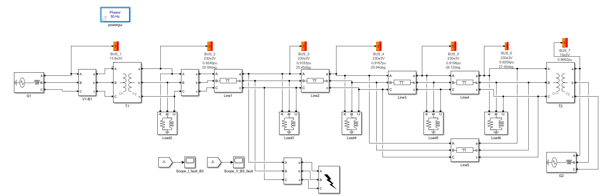

# ELEC5204 · 三相稳态建模、潮流与短路故障分析

[返回作品集](README.md)

**Power Systems Analysis and Protection｜MATLAB、Simulink、Simscape Electrical Specialized Power Systems**

本项目由两次实验组成：先建立三相平衡电路，验证负荷参数、功率因数和电源内阻的影响；再搭建七节点电力网络，将正常潮流、变压器接线组别、三相短路和单相接地分析连接起来。成果包括两份实验报告、四个 Lab 1 模型、三个 Lab 2 模型，以及两套故障解析计算脚本。

## 工作范围

| 阶段 | 建立或完成的内容 | 用来回答的问题 |
|---|---|---|
| Lab 1 三相平衡系统 | 纯电阻负荷、并联 RL 负荷、非理想电源 | 负荷参数和电源内阻怎样影响端电压、电流和功率因数 |
| Lab 2 正常运行 | 七节点网络、标幺参数、潮流初始化 | 正常运行点和各母线电压如何确定 |
| Lab 2 变压器对比 | D1–Yg、D11–Yg、Yg–Yg 接线 | 相位偏移和接地通路如何影响分析 |
| Lab 2 故障分析 | Bus 3 三相短路、A 相接地 | 故障电流、母线电压和各相响应有什么区别 |

## Lab 1 · 从电路参数到三相波形

### 纯电阻负荷与两种参数化方式

以 50 Hz、相电压有效值 100 V 的三相电源和每相 50 Ω 的线路电阻为基础，由额定总有功功率 600 W 推导每相 50 Ω 的星形电阻负荷。分别使用“额定功率定义负荷”和“直接输入阻抗”建立模型，对照相电压、电流及其峰值，验证两种设置的稳态等效性。

该工况中负荷端相电压峰值约 **70.7 V**、电流峰值约 **1.414 A**，电压与电流同相，功率因数为 **1**。

### 并联 RL 负荷与无功功率

将负荷改为总有功 600 W、感性无功约 381.972 var 的并联 RL 负荷，推导得到 **R = 50 Ω、L = 0.25 H**。通过功率定义和元件定义两种模型比较，验证参数换算，并区分启动暂态与稳态结果。

负荷功率因数约为 **0.845**，电流滞后负荷电压约 **32.3°**。对照波形解释：有功功率相同并不意味着电流相同，感性无功会增加电流及线路压降。

### 电源内阻与端电压下降

依据短路容量和 X/R 比推导电源内部串联 R、L，再加入原有三相系统。对比理想电源与非理想电源下的波形，负荷电压峰值由约 **67.4 V** 降至 **49.8 V**；同时区分负荷本身的功率因数与包含电源内部阻抗的整体系统功率因数。

## Lab 2 · 七节点网络与正常潮流

建立包含两台电源、两台变压器、五段线路和多处 PQ 负荷的七节点三相网络，统一到 **100 MVA** 基准，并按变比选取各电压区的基准电压。先完成元件标幺值换算和网络接线，再使用潮流工具确定故障前状态。

对比三种变压器接线后，母线电压幅值和发电机输出基本保持一致，输电侧的电压相角则产生约 ±30° 的相对变化。这一步用于核对接线组别、相角参考和故障前电压条件，而不只检查波形是否“看起来正常”。

| 正常运行指标 | 结果 |
|---|---:|
| 系统三相功率基准 | 100 MVA |
| 故障计算电压基准 | 230 kV，线电压有效值 |
| PQ 母线电压范围 | 0.9167–0.9259 p.u. |
| Bus 3 故障前电压幅值 | 0.9183 p.u. |
| 230 kV 侧电流基准 | 251.0219 A |

## 三相短路与 A 相接地

三相短路使用正序网络，构造节点导纳矩阵并得到 Zbus，以 Bus 3 故障前电压及 Z33 计算戴维南等值。再通过叠加求各母线故障电压和支路电流，并在 Simulink 中观察故障于 1 s 投入前后的变化。

A 相接地故障进一步建立正序、负序、零序网络，串联三序等值求序电流，再转换为三相电流及电压。重点检查故障相与非故障相的区别，以及变压器接线和接地回路的作用。

| 指标 | 三相短路 | A 相接地 |
|---|---:|---:|
| 故障点 | Bus 3 | Bus 3 |
| 解析故障电流 | 10.9194 p.u. | 10.9799 p.u. |
| 换算实际电流 | 2.7410 kA | 2.7562 kA |
| 故障点电压特征 | 三相均塌陷 | A 相约为 0，B、C 相仍有电压 |
| 使用的网络 | 正序 | 正序、负序、零序 |

其中正序戴维南阻抗为 **0.017531 + j0.082250 p.u.**。接地故障分析还得到负序 **0.019662 + j0.086908 p.u.** 和零序 **0.012207 + j0.076835 p.u.**；Bus 3 非故障相电压约为 **0.9336、0.8994 p.u.**。

## 实施与核查

- 将手算使用的电压、电流基准与模型的测量输出统一，区分线量、相量、有效值、峰值和标幺值。
- 分别保存基础网络、三相短路和接地故障模型，明确故障投入时间、故障相和接地设置。
- 沿 Bus 3 电压、故障支路电流及 Bus 1 三相电压检查故障影响，避免只观察单一电流曲线。
- 将正常潮流输出作为故障计算的初始条件，使理论计算与仿真使用同一个运行点。

这些工作对应电气运维中的一次系统识读、负荷与无功分析、电压异常定位、短路电流水平判断，以及测量口径核对。

## 报告与工程文件

- [Lab 1 三相平衡系统报告](5204-lab1-report.pdf)
- [Lab 2 七节点潮流与短路分析报告](5204-lab2-report.pdf)
- [完整实验资料包：模型、解析脚本与两份报告](5204_selected_source.zip)

资料包中 `Lab1/` 包含四个负荷与电源模型；`Lab2/` 包含基础网络、三相短路、A 相接地模型和对应 MATLAB 计算脚本。
