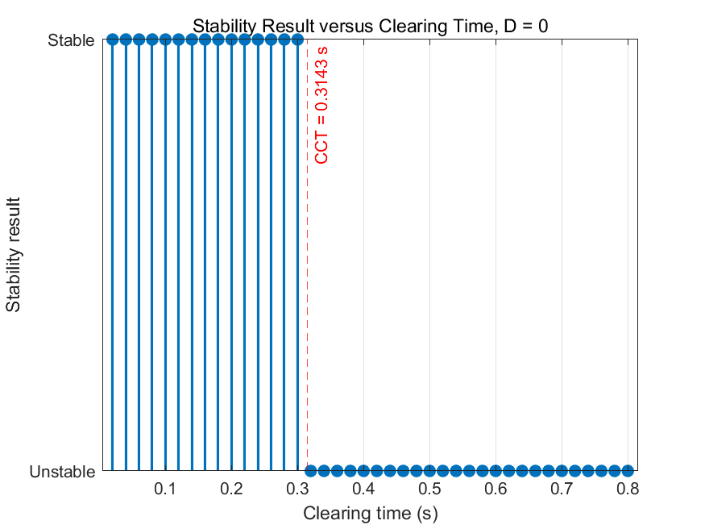
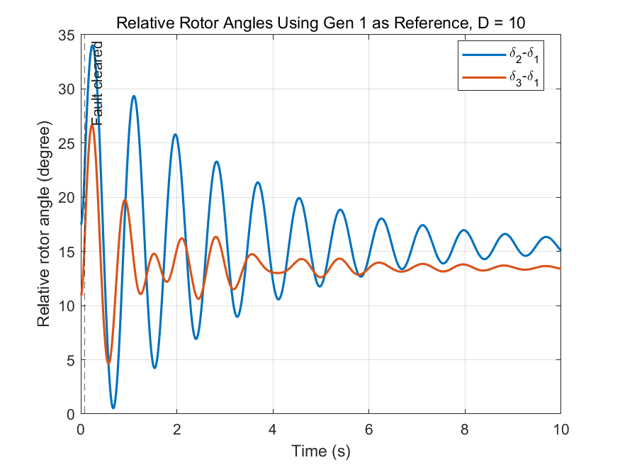

# ELEC5211 · 多机系统动态稳定性与故障清除时间

[返回作品集](README.md)

**课程：Power System Dynamics and Control｜三人小组项目**

## 从稳态运行到故障恢复

基于 IEEE 3 机 9 节点系统，先用 MATPOWER 求解潮流，分析发电机电压定值、负荷和无功补偿的影响。再由潮流结果计算发电机暂态内电势与初始功角，用经典二阶模型及 MATLAB ode45 求解故障期间和清除后的动态响应。

## 分析内容

| 阶段 | 完成的工作 |
|---|---|
| 稳态 | 基准潮流、电压定值变化、参考角变化、负荷缩放、无功补偿 |
| 初始化 | 电流、暂态内电势、转子角及惯性参数统一，检查机械与电磁功率平衡 |
| 故障 | Bus 7 三相故障，切换故障前、故障中、故障后网络 |
| 恢复 | 比较无阻尼与有阻尼时的相对功角和转速振荡 |
| 稳定边界 | 粗搜索加二分迭代，估计临界故障清除时间 |

## 结果

在项目定义的无阻尼工况下，以相对参考机功角超过 180° 作为失稳判据，记录的临界清除时间约为 **0.31433 s**；50 Hz 下约为 15.72 周波。对比的 4 周波清除工况为 0.08 s。

加入阻尼后，相对功角振荡衰减更明显。

## 结果分析

故障清除时间影响转子加速和失步风险，初始运行点、惯量、负荷及故障后网络结构共同决定系统的稳定边界。仿真中，0.08 s 清除工况的相对功角保持有界；增加阻尼后，功角与转速振荡衰减加快。

故障模型采用 Bus 7 三相短路，清除时切除 6–7 支路。另通过 SMIB 实验分析功角特性、机械功率扰动和同步稳定性。

## 项目文件

[下载 MATLAB 脚本、SMIB 模型及数值结果](5211_selected_source.zip)

工具：MATLAB、MATPOWER、ode45。
