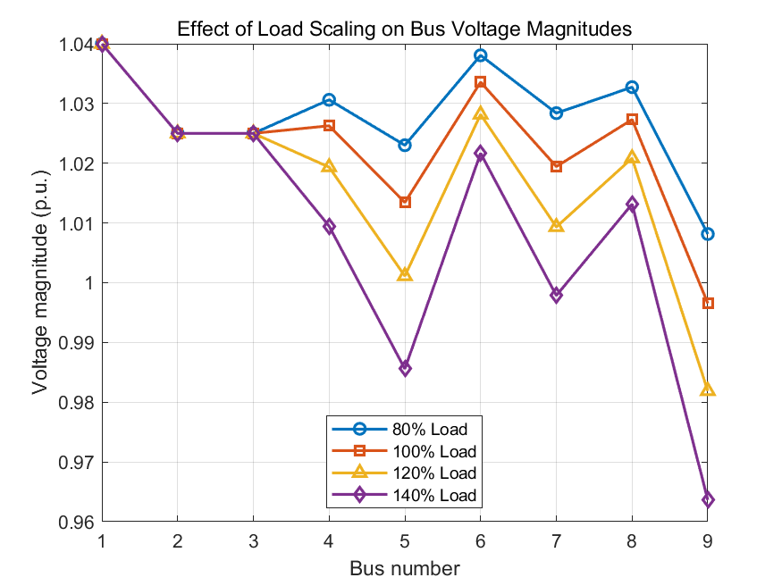
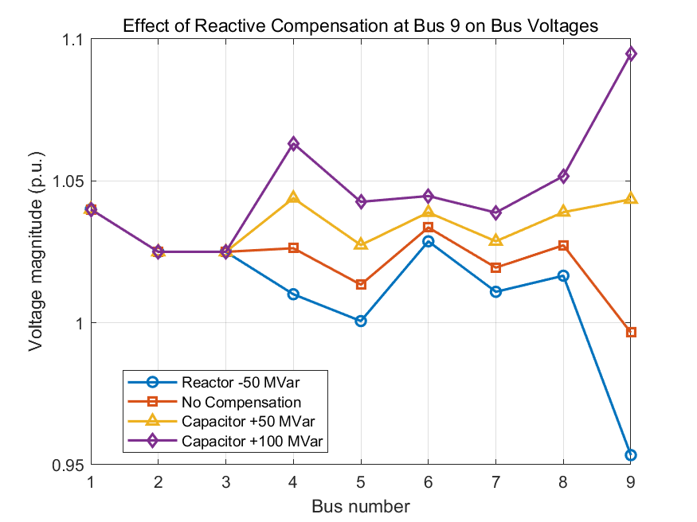

# ELEC5211 · 从单机功角到多机系统稳定性分析

[返回作品集](README.md)

**Power System Dynamics and Control｜三人小组｜MATLAB、MATPOWER、ode45**

本项目包含单机无穷大系统实验和 IEEE 三机九节点综合项目。工作从功率平衡和功角曲线出发，延伸到潮流敏感性、无功补偿、动态模型初始化、三相故障、故障后振荡及临界清除时间。形成两份报告、四个多机系统主脚本、SMIB 脚本、数值结果文件和 **23 幅多机系统成果图**。

## 一、SMIB · 建立稳定性分析的基础

建立同步发电机经变压器和线路连接无穷大母线的模型，推导端点有功、无功平衡及转子运动方程。使用恒定暂态内电势的经典二阶模型，将转子功角和转速偏差作为状态量，通过 ode45 求解扰动响应。

| 分析内容 | 完成的工作与结果 |
|---|---|
| 初始运行点 | 计算电流、暂态内电势和转子角；E′ 约 1.9036 p.u.，初始功角约 31.69° |
| 功角曲线 | 建立 Pe = Pmax sin δ，求得 Pmax 约 1.9036 p.u. |
| 小幅功率阶跃 | 在 1 s 将机械输入由 1.0 提高至 1.1 p.u.，观察功角、转速和电功率的衰减振荡 |
| 超出传输能力 | 采用 2.0 p.u. 机械功率，观察功角持续增大、转速偏差不回零和失步 |

这一实验把“输入功率超过电气输出能力”与转子加速、失步联系起来，也为后续多机系统中的初值设置、阻尼和相对功角判据建立基础。

## 二、三机九节点 · 稳态运行与参数敏感性

采用 **100 MVA、50 Hz** 系统基准，三台发电机位于 Bus 1、2、3。按实际 MATPOWER 模型将负荷配置在 **Bus 5、7、9**，总负荷为 **315 MW + j110 Mvar**。使用 Newton–Raphson 潮流求母线电压、发电机 P/Q 和支路潮流。

### Task 1：基准潮流与电压定值

基准发电机电压定值为 `[1.04, 1.025, 1.025]` p.u.，并分别测试较高的 `[1.06, 1.04, 1.04]` 和较低的 `[1.02, 1.01, 1.01]`。对比全网电压和三台机组无功输出，分析电压设定如何改变无功分配。

另将参考母线相角设为 **0°、+10°、−10°**。各母线角度整体平移，而电压幅值和功率分布基本不变，从而区分坐标参考变化与真实运行状态变化。

### Task 2：负荷变化与薄弱节点

将有功、无功同时缩放到基准的 **80%、100%、120%、140%**，比较各母线电压、系统损耗及最低电压。基准情况下 Bus 9 电压约 **0.9965 p.u.**；140% 负荷时降至约 **0.964 p.u.**，因此将 Bus 9 作为后续无功支撑分析的重点。

### Task 3：无功补偿及过补偿

在 Bus 9 比较 **−50、0、+50、+100 Mvar** 四种并联补偿工况。电抗器吸收无功后电压下降；电容器就地供给无功后电压抬升。+100 Mvar 工况又将局部电压推近 **1.10 p.u.**，说明补偿容量需要兼顾低电压改善和过电压风险。

## 三、从潮流解到动态模型

### Task 4：初始化与平衡校验

由潮流的机端复电压和发电机复功率计算电流，再求暂态内电势和初始功角。将 MW/Mvar 转成 100 MVA 基准的标幺功率，按储能数据换算惯性常数，并令初始转速为 1 p.u.、机械功率等于初始电功率。

| 发电机 | 暂态内电势 E′ / p.u. | 初始功角 / ° | H / s |
|---|---:|---:|---:|
| G1 | 1.0561 | 2.272 | 23.64 |
| G2 | 1.0473 | 19.728 | 6.40 |
| G3 | 1.0132 | 13.181 | 3.01 |

检查三台机组的机械—电磁功率差及初始状态导数，使故障前模型处于平衡。网络中显式加入发电机暂态电抗和恒阻抗负荷，再进行 Kron 消元，得到内电势节点之间的约化导纳矩阵。

### Task 5：三相故障期间的响应

在 Bus 7 接入大并联导纳模拟三相短路，计算故障中网络的约化导纳矩阵。联合积分三台机组的转子运动方程，同时恢复母线电压，记录功角、转速及电压变化，解释故障期间电气传输能力下降与转子加速之间的关系。

### Task 6：故障清除与阻尼

按实际 case9 支路编号在清除时移除故障并切除 **6–7 支路**；故障中计算的终态直接接续为故障后初态。采用 **4 周波，即 0.08 s** 清除，并比较 D = 0 与 D = 10 的响应。

无阻尼情况下相对功角保持有界但持续振荡；加入阻尼后，功角和转速振荡明显衰减。分别绘制绝对功角、以 G1 为参考的相对功角、转速及母线电压，区分“仍同步”和“振荡衰减良好”。

### Task 7：临界清除时间

在 D = 0 工况下，先以 **0.02 s** 步长扫描清除时间，再对稳定与失稳之间的区间二分。采用 10 s 观察窗口，以相对参考机功角幅值达到 180° 作为失步事件，并检查边界两侧的时域曲线。

**该模型与故障工况下的 CCT 约为 0.31433 s，即 50 Hz 下的 15.72 周波。** 0.08 s 清除工况位于这一边界以内。

## 实施中解决的问题

- 将 MATPOWER 的机组、负荷和支路编号与动态网络统一，核对实际存在的 6–7 支路。
- 将潮流输出的 MW/Mvar、相角单位和动态方程中的标幺量、弧度统一，避免初始即出现虚假加速。
- 将故障中和故障后分为两段积分，传递清除瞬间状态，保留动态连续性。
- 整理图像自动导出、结果命名和 MAT 数据保存，使潮流对比、初始化及稳定边界能够对应到报告中的具体图表。

这些工作支持对电压薄弱点、无功支撑、扰动后恢复过程和保护动作时间的理解，也体现了从异常曲线追查模型、单位和网络拓扑的分析方法。

## 报告与工程成果

- [SMIB 功角与扰动实验报告](5211-smib-report.pdf)
- [三机九节点完整项目报告](5211-project-report.pdf)
- [完整资料包：MATLAB 脚本、数值结果、23 幅成果图与报告](5211_selected_source.zip)

`project5211_task1_basecase.m` 包含 Task 1–4；Task 5、6、7 分别对应故障中、故障清除和 CCT 搜索。配置 MATPOWER 后可按任务顺序查看模型及输出。
