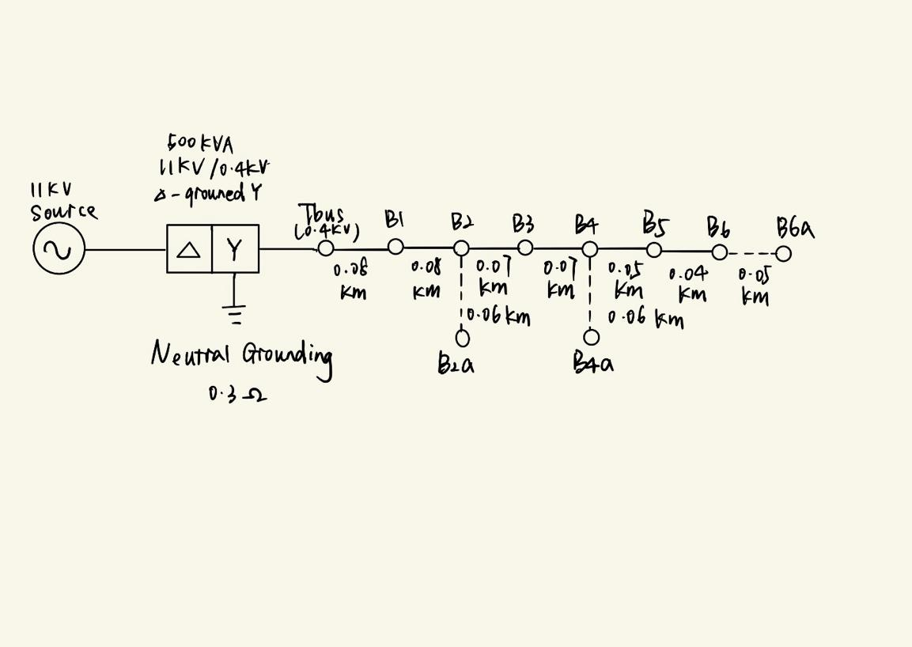

# ELEC5208 · 配电网建模、家庭储能与动态运行区间

[返回作品集](README.md)

**Active Distribution Systems｜四人小组｜Julia、OpenDSS、JuMP、HiGHS、Clarabel**

项目分三个阶段：建立三相四线低压配电网及全年运行基线；加入光伏、电池与规则式家庭能源管理；进一步用线性规划优化家庭调度，并通过二阶锥规划计算各节点的动态出口功率限制。最终将家庭策略放回完整配电网，比较全年电压、三相不平衡和反向潮流。

## 我的工作

| 阶段 | 报告记录的个人工作 |
|---|---|
| Task I 配电网与潮流 | 代码实现、与组员共同记录结果；参与数据选择和网络拓扑设计 |
| Task II 规则式 HEMS | 代码修改与改进、与组员共同记录结果 |
| Task III 优化调度与 DOE | 代码修改与改进、与组员共同记录结果 |

## Task I · 建立全年运行基线

### 网络及设备建模

建立辐射状三相四线馈线：主干为 `Tbus–B1–B2–B3–B4–B5–B6`，在 B2、B4、B6 分别设置支线，最远节点为 B6a。模型显式保留中性线和接地路径，而不是使用平衡单相等效。

| 模型组成 | 实现参数 |
|---|---|
| 配电变压器 | 500 kVA，11 kV / 0.4 kV，Δ–接地 Y |
| 中性点接地 | 变压器侧 0.3 Ω；负荷母线 10 Ω |
| 馈线 | 总长 0.56 km，9 段，最远路径 7 段 |
| 导线 | Neptune，AC 电阻 0.224 Ω/km，热电流参数 479 A |
| 用户负荷 | 36 个单相相—中性线负荷，分配到不同母线及相别 |
| 负荷输入 | 9 条实际智能电表曲线，经缩放和分配扩展至 36 个用户 |
| 年度分辨率 | 5 分钟，共 105,120 步 |

通过 OpenDSS 的 WireData、LineSpacing 和 LineGeometry 建立导线参数与空间布置，使线路阻抗包含相线和中性线之间的耦合。

### 数据与仿真流程

处理时间戳、夏令时歧义和记录长度，将各曲线对齐到全年 105,120 点。按配置表将用户曲线分配到母线、相别和缩放系数，再生成 OpenDSS LoadShape。依次进行静态快照、一周 2,016 步测试和全年仿真，记录收敛状态、各节点相电压、馈线功率、PVUR 与 VUF。

### 低电压定位与模型改进

早期模型曾出现约 **0.737 p.u.** 的低电压及收敛问题。通过最差时刻快照、母线排序和分相比较，发现问题集中于远端馈线及较重载的 A 相。测试增大变压器容量后，最差电压改善有限，进一步将分析重点放在线路压降、导线参数、馈线长度和负荷相别分配上。

经更换导线、调整线路长度和负荷相别后，最终全年 **105,120 步全部收敛**，最低电压约 **0.90628 p.u.**、最高约 **1.01149 p.u.**。最弱点位于 **B6a**；最大 PVUR 约 **6.4195%**，最大 VUF 约 **3.0093%**。这也说明电压幅值满足设定区间，并不意味着三相不平衡问题同时消失。

## Task II · 光伏、电池与规则式 HEMS

在原有馈线上加入住宅光伏和电池，以本地负荷、光伏出力、SOC 和电价为输入决定充放电。电池容量分别为 **10、20 kWh**，充放电功率上限均为 **5 kW**。先比较单节点 24 小时功率和 SOC，再扩展至全馈线全年分析。

同时测试普通分时电价和 **SSO 11:00–13:59 免费购电窗口**，观察免费时段充电如何改变电池利用、购电和反送电。保留仅光伏、两种电池容量及其 SSO 组合，共六类 DER 场景。

| 普通电价下的年度指标 | 仅光伏 | 光伏＋10 kWh | 光伏＋20 kWh |
|---|---:|---:|---:|
| 最低电压 / p.u. | 0.913709 | 0.913725 | 0.913725 |
| 最高电压 / p.u. | 1.070492 | 1.070175 | 1.070175 |
| 年反送电量 / kWh | 24,087.22 | 18,817.55 | 18,389.54 |
| 反向潮流时间 / h | 1,586.00 | 1,319.92 | 1,301.33 |
| 最大 VUF / % | 3.3881 | 3.5172 | 3.5172 |

10 kWh 电池使年反送电量相对仅光伏场景减少约 **21.9%**；增加至 20 kWh 后仍有进一步改善，但两种容量的峰值表现接近，体现 **5 kW 功率上限** 对瞬时调节能力的限制。最大 VUF 未同步下降，因此同时分析电池位置、相别和调度时刻，而不只比较容量。

## Task III · 优化调度与配网协调

### 家庭能源管理的线性规划

使用 Julia / JuMP 和 HiGHS，将家庭调度写成 288 个 5 分钟时段的日优化问题。变量包括购电、售电、光伏使用、弃光、电池充放电功率和 SOC；约束包括功率平衡、5 kW 功率边界、储能容量、效率和 SOC 递推。目标为购电费用减去售电收益，并加入小幅电池循环惩罚。

在实现中将前一天结束 SOC 传递为下一天初始 SOC，避免每日重置到 50% 产生人为能量；全年末端设置能量闭合条件。对普通电价与 SSO、10 与 20 kWh 电池分别检查 24 小时调度及年度结果。

### SOCP 动态运行区间

以支路潮流模型和二阶锥松弛建立 DOE，使用 Clarabel 求解。将节点电压与支路电流限制转换为分节点、分相的出口功率边界，再把边界加入家庭优化并返回 OpenDSS 验证。

10 个 HEMS 节点中，部分近端或负担较轻相别的出口边界高于住宅 5 kW 逆变器能力，对住宅而言不构成实际约束；远端 A 相节点则受到约 **1–3 kW** 的更紧边界约束。由此解释同一馈线中位置和相别不同的用户为何不适合采用完全相同的出口上限。

| Task III 全年对比 | 仅光伏 | 优化 HEMS 10 kWh | 优化 HEMS 20 kWh | 加入 DOE |
|---|---:|---:|---:|---:|
| 年反送电量 / MWh | 24.086 | 13.664 | 13.414 | 9.313 |
| 反向潮流时间 / h | 1,586.00 | 1,138.58 | 1,132.58 | 986.25 |
| 最低电压 / p.u. | 0.9137 | 0.8986 | 0.8855 | 0.8855 |
| 最高电压 / p.u. | 1.0705 | 1.0705 | 1.0705 | 1.0490 |
| 电压越限步数 | 0 | 1 | 2 | 2 |

这张表对应 **Task III 的优化调度**；前表对应 **Task II 的规则式调度**，两种控制方法分别比较。DOE 降低了反送电量和最高电压，但全年仍有两步低电压，说明出口管理和负荷侧电压支撑需要结合。

DOE 计算使用代表周并扩展到全年，且按相简化求解；因此在结果分析中进一步讨论季节差异、相间耦合、优化模型与完整三相潮流之间的差别。

## 工程分析能力与成果

项目形成了从真实时间序列、网络建模、控制策略到全年验证的完整流程：既能在全年结果中定位具体节点、时刻和相别，也能比较策略的能量收益、电压表现及不平衡副作用。调试涉及目录与数据依赖整理、年度曲线长度统一、相别配置、SOC 跨日连续性及优化结果回写。

- [Task I 配电网建模与全年潮流报告](5208-task1-report.pdf)
- [Task II 规则式 HEMS 与电池场景报告](5208-task2-report.pdf)
- [Task III 优化 HEMS 与 DOE 报告](5208-task3-report.pdf)
- [完整项目资料包：三个阶段代码、DSS 网络、成果图、汇总表与报告](5208_selected_source.zip)
- [Task II 普通电价年度对比数据](5208_annual_summary.csv)
