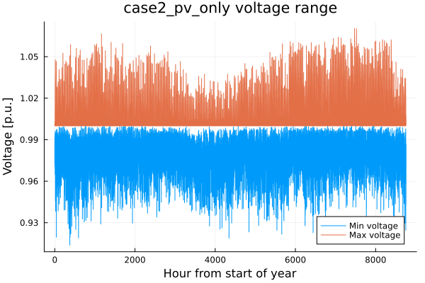
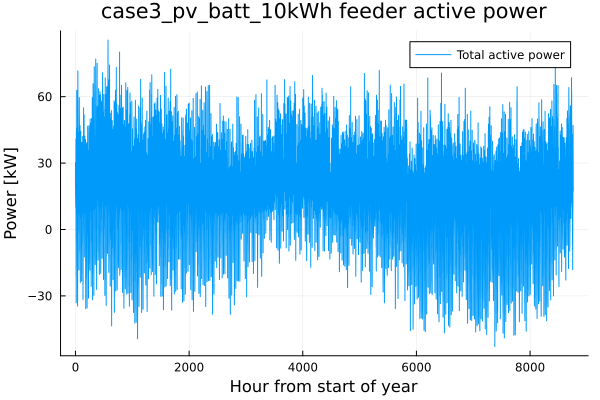

# ELEC5208 · 配电网运行评估与家庭储能

[返回作品集](README.md)

**课程：Active Distribution Systems｜四人小组项目**

**个人工作：代码修改与改进、仿真结果记录及场景对比。**

## Task I · 建立全年运行基线

使用 Julia 处理负荷和光伏时间序列，构建 OpenDSS 低压配电网，在 5 分钟分辨率下完成全年 **105,120 步**仿真。记录母线电压、馈线功率、收敛状态以及 PVUR / VUF 三相不平衡指标。

## Task II · 规则式家庭能源管理

对比仅接入光伏、光伏与 10 kWh 电池、光伏与 20 kWh 电池等场景。HEMS 根据本地负荷、光伏、电池荷电状态与电价决定充放电，并设置 5 kW 充放电功率上限。

| 指标 | 光伏 | 光伏 + 10 kWh 电池 | 光伏 + 20 kWh 电池 |
|---|---:|---:|---:|
| 年度步数 | 105,120 | 105,120 | 105,120 |
| 最低电压 / p.u. | 0.913709 | 0.913725 | 0.913725 |
| 最高电压 / p.u. | 1.070492 | 1.070175 | 1.070175 |
| 年馈线反送电量 / kWh | 24,087.22 | 18,817.55 | 18,389.54 |
| 反向潮流时间 / h | 1,586.00 | 1,319.92 | 1,301.33 |
| 最大 VUF / % | 3.3881 | 3.5172 | 3.5172 |

以光伏场景为基准，10 kWh 电池场景的年反送电量减少约 **21.9%**。但瞬时最大反送功率基本未变，最大 VUF 也未同步改善，说明储能容量、功率限制、位置与相别需要一起考虑。

仿真采用 0.9–1.1 p.u. 的电压判定区间，并结合 VUF 指标分析三相不平衡。

## Task III · 优化调度与动态运行区间

使用 Julia / JuMP 建立家庭能源管理优化模型，以 HiGHS 处理线性规划；再通过 Clarabel 求解基于 SOCP 松弛的配网动态运行区间，并用 OpenDSS 检查对应调度。

Task III 报告中，动态运行区间场景的年度反送电量为 **9.313 MWh**、最高电压约 **1.0490 p.u.**，仍有两个低电压越限步。结果说明，出口功率限制能够缓解光伏反送与电压升高，低电压问题还需要结合负荷和电压支撑措施处理。

SOCP 模型按相求解动态运行区间，以代表周扩展全年控制曲线，再通过 OpenDSS 分析运行结果。

## 运维相关能力

- 批量处理运行数据，定位全年最弱电压时刻和节点。
- 用电压、负荷、馈线功率与不平衡指标共同解释异常。
- 比较控制策略的收益与副作用，保留低电压等未解决问题。
- 将软件输出、汇总表和技术报告对应起来，形成可追踪的分析流程。

## 项目文件

- [规则式 HEMS、优化式 HEMS 与 DOE 代码](5208_selected_source.zip)
- [年度场景对比数据](5208_annual_summary.csv)
