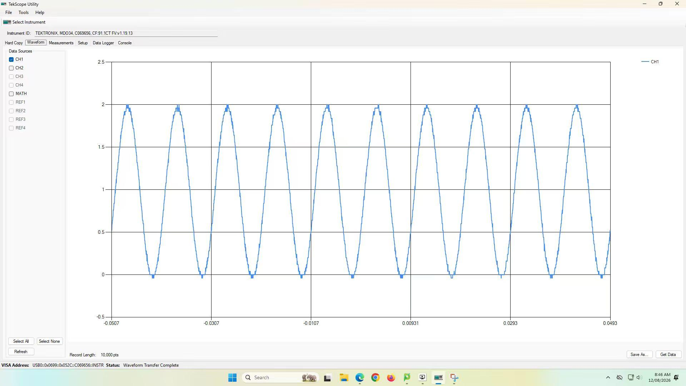
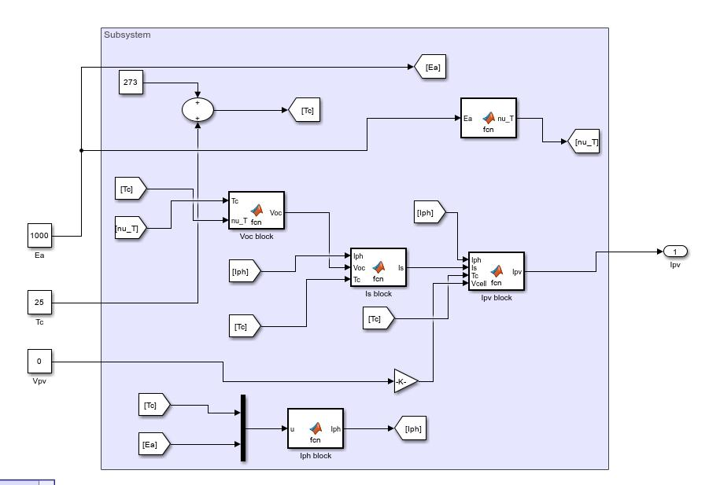
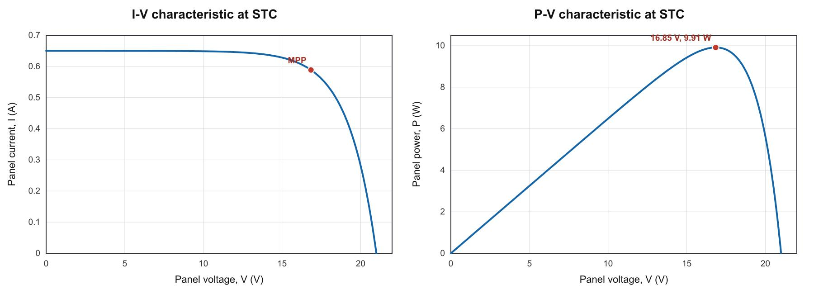
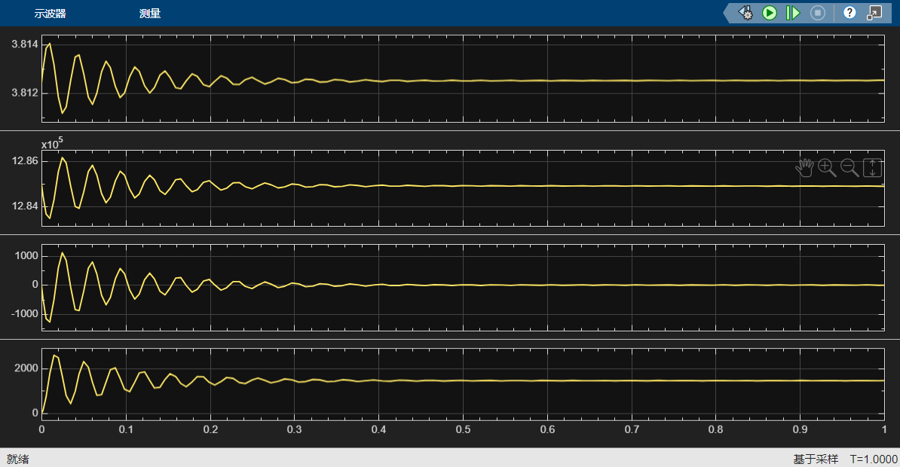

# ELEC5206 · 电气测量、光伏控制与风电实验

[返回作品集](README.md)

**Sustainable Energy Systems｜Bench 4，三人小组｜实物实验与 MATLAB / Simulink 建模**

本项目覆盖从仪器使用、光伏特性测量，到光伏参数辨识、微控制器 MPPT、风机负载试验和风机—永磁同步发电机联合仿真。成果包括 **Lab 1–5 五份报告**、两组完整 MPPT 测量记录、27 个风机工况、实验曲线、Simulink 模型图及 PMSG 联调波形。

个人参与实验结果处理、理论与测量对照、图表制作和报告整理；风机实验报告中的分工为数据处理、绘图和报告写作。联合仿真阶段进一步参与 dq 模型连线、符号和稳态工作点的核对。

## 实验总览

| 实验 | 完成的内容 | 主要成果 |
|---|---|---|
| Lab 1 测量设备 | 函数发生器、双通道示波器、MATH、PWM、DACI 分压测量 | 波形与相位核对、82 Ω 电阻辨识、交流 RMS 交叉核查 |
| Lab 2 光伏特性 | 实体电阻扫描、Buck 占空比扫描 | I–V / P–V 曲线、开路/短路估计、两种方法的采样最大功率点 |
| Lab 3 光伏仿真 | 36 串电池单二极管模型、参数辨识、环境扫参 | MATLAB 参数求解、Simulink 模型、辐照度和温度影响曲线 |
| Lab 4 MPPT | PICAXE 14M2、Buck、爬山控制、面板位置变化 | 两组各 201 条记录、控制扰动波形与运行点对比 |
| Lab 5 风机特性 | 三种风速、九种电阻工况 | 转矩—转速、电流—电压、机械/电功率及转换效率 |
| 风机—PMSG 联调 | 气动、dq 电流、电磁转矩、转速模块 | q 轴符号定位、机械—电磁平衡、衰减振荡与稳态波形 |

## Lab 1 · 仪器与测量链路

使用 Rigol DG1062Z、Tektronix MDO 示波器、Lab-Volt DACI 9063 和 LVDAC-EMS，验证正弦波幅值、频率、双通道相位和波形相加，再产生 100 kHz PWM，比较 20%、40%、60% 三种占空比。

| 检查项 | 结果 |
|---|---:|
| CH1 幅值，设定 2.000 Vpp | 测得 2.040 Vpp |
| 频率，设定 100 Hz | 测得 100.040 Hz |
| CH2 相对 CH1 的相位，设定 +90° | 测得 +89.892° |
| PWM 正占空比 | 19.997%、39.998%、59.998% |
| PWM 频率 | 约 100 kHz |

用 82 Ω 和 40 Ω 串联分压，在六组直流测量上进行 E–I 线性拟合，得到 **82.67 Ω、R² = 0.9995**，相对额定 82 Ω 偏差约 0.81%。交流部分根据实际探头接线采用 **CH1 − CH2** 得到差分电压：示波器直接 RMS 为 **3.355 V**，Lab-Volt 为 **3.320 V**，两者相差约 **1.05%**。

核查中将发生器设定值与实际测得输入分开，使用实际 **14.600 Vpp** 输入进行理论比较，避免把设定 20 Vpp 直接当成真实输入；同时区分直接 RMS 与由峰峰值换算的 RMS。

## Lab 2 · 光伏特性与电子负载匹配

对卤素灯照射下的 PV 组件进行两类扫描：先改变实体电阻记录 **12 个点**，再通过 Buck 变换器驱动固定 **2 Ω** 负载，改变占空比记录 **18 个点**，据此绘制 I–V 和 P–V 曲线。

| 扫描方法 | 采样最大功率 | 对应电压 | 对应电流 | 负载或控制设置 |
|---|---:|---:|---:|---|
| 实体电阻 | 4.728 W | 13.81 V | 0.343 A | 40 Ω |
| Buck 占空比 | 4.826 W | 14.04 V | 0.344 A | 26% |

开路电压估计约 **18.23 V**，短路电流约 **0.401 A**。利用 `Rin ≈ RL / D²` 解释 Buck 如何改变 PV 看到的等效负载，并用 P 与 V×I 的差异识别端点读数、测量模式和零点偏移问题。两次扫描中的峰值是各自记录到的最大点，用于解释负载匹配，不能直接当作变换器效率。

## Lab 3 · BP SX-10 参数辨识与 Simulink 模型

依据 BP SX-10 组件参数，将 **36 个串联电池单元**转换为单电池模型；使用开路和额定最大功率点条件，通过 MATLAB `fsolve` 求单二极管模型的理想因子及饱和电流，再在 Simulink 中实现辐照度、温度和端电压到输出电流的计算。

| 参数或仿真结果 | 数值 |
|---|---:|
| 二极管理想因子 | 约 1.905 |
| 饱和电流 | 约 4.3576 μA |
| STC 最大功率点电压 | 16.846 V |
| STC 最大功率点电流 | 0.588 A |
| STC 最大功率 | 9.912 W |

分别扫描 **200、600、800、1,000 W/m²** 辐照度和 **0、25、50 °C** 温度，比较整组 I–V / P–V 曲线。短路电流随辐照度由约 0.130 A 增至 0.650 A；温度上升时，电流仅小幅增加，而开路电压及最大功率下降。另在固定 18.8 V 运行点分析输出电流，区分短路区域与接近开路区域的响应。

## Lab 4 · PICAXE 与 Buck 的 MPPT

在 **PICAXE 14M2** 上实现固定步长爬山控制，初始占空比 **0.10**、扰动步长 **0.01**。对固定电阻负载，利用输出电压与负载功率的单调关系决定继续扰动或反向；通过 PWM 改变 Buck 输入等效阻抗，调整光伏运行点。

在初始位置及面板相对初始位置旋转 **60°** 后各记录约 200 s。使用完整 **201 条**有效记录和实际时间戳绘图，分析电压、电流、功率及固定步长控制的稳态扰动。

| 指标 | 初始位置 | 旋转 60° 后 |
|---|---:|---:|
| 平均电压 / V | 9.440 | 6.770 |
| 平均电流 / A | 0.430 | 0.318 |
| 平均功率 / W | 4.064 | 2.153 |
| 功率标准差 / W | 0.153 | 0.094 |
| 最大记录功率 / W | 4.463 | 2.336 |

位置改变后平均功率降低约 **47.0%**，两组曲线仍呈现有界的邻近运行点切换，体现控制器在不同可用光功率条件下继续搜索。进一步通过 V×I 核对记录功率，并分析步长、采样间隔、卤素灯加热和电气噪声对曲线的影响。

## Lab 5 · 风机负载扫描与能量转换

对实际记录的 **5、7、10 m/s** 三种设置，依次扫描开路、400、229、45、30、15、7.5、5 Ω 和短路，共 **27 个工况**。整理转速、转矩、机械功率、直流电压、电流和电功率，用 `Pm = 2πnT/60` 及 `Pe = VI` 交叉核对。

| 风速 / m/s | 最大电功率 / W | 对应转速 / r/min | 对应电阻 / Ω | 该点电功率/机械功率 |
|---|---:|---:|---:|---:|
| 5 | 22.61 | 458 | 30 | 74.3% |
| 7 | 65.35 | 889 | 45 | 87.3% |
| 10 | 181.00 | 1,022 | 15 | 81.3% |

绘制转矩—转速、电流—电压及两类功率—转速曲线，说明开路时高电压不等于高功率，接近短路时转速和电压下降也会限制功率。对传感器极性、开路零点偏移和低功率下的比值异常分别处理，并将发电机、整流和线路的点效率与风轮气动 Cp 区分。

## 风机—PMSG 联合仿真与问题定位

将风机气动模型、永磁同步发电机 dq 电流方程、电磁转矩及机械转速动态连接起来，检查风功率、机械功率、电磁转矩和速度之间的平衡。

调试中曾出现转速持续上升或下降。通过逐项核对 dq 子系统的端口与求和符号，定位 **q 轴电压和永磁磁链项的符号错误**，并结合 `J·dω/dt = Tm − Te − Bm·ω` 检查机械方程。历史联调波形显示，在 **12 m/s、桨距角 0°** 条件下，转速经衰减振荡稳定在约 **3.8124 rad/s**，机械功率约 **1.285 MW**，d 轴电流趋近 0，q 轴电流约 1.4 kA。

## 对电气运维的实际关联

这一系列工作覆盖测量接线与仪器设置、PWM 和功率变换、设备特性测试、传感器偏差识别，以及由异常波形回查参数、单位和模型符号。数据整理不止是画图，还包括实测值与设定值区分、功率一致性检查、负载匹配和扰动后恢复过程的解释。

## 完整报告与数据

- [Lab 1 仪器与测量设备报告](5206-lab1-report.pdf)
- [Lab 2 光伏组件特性报告](5206-lab2-report.pdf)
- [Lab 3 光伏单二极管建模报告](5206-lab3-report.pdf)
- [Lab 4 光伏 MPPT 控制报告](5206-lab4-report.pdf)
- [Lab 5 风机功率特性报告](5206-lab5-report.pdf)
- [完整实验资料包：五份报告、数据和成果图](5206-laboratory-materials.zip)
- [MPPT 初始位置数据](5206_mppt_normal.csv) · [旋转后数据](5206_mppt_tilted.csv) · [风机 27 个工况](5206_wind_measurements.csv)
