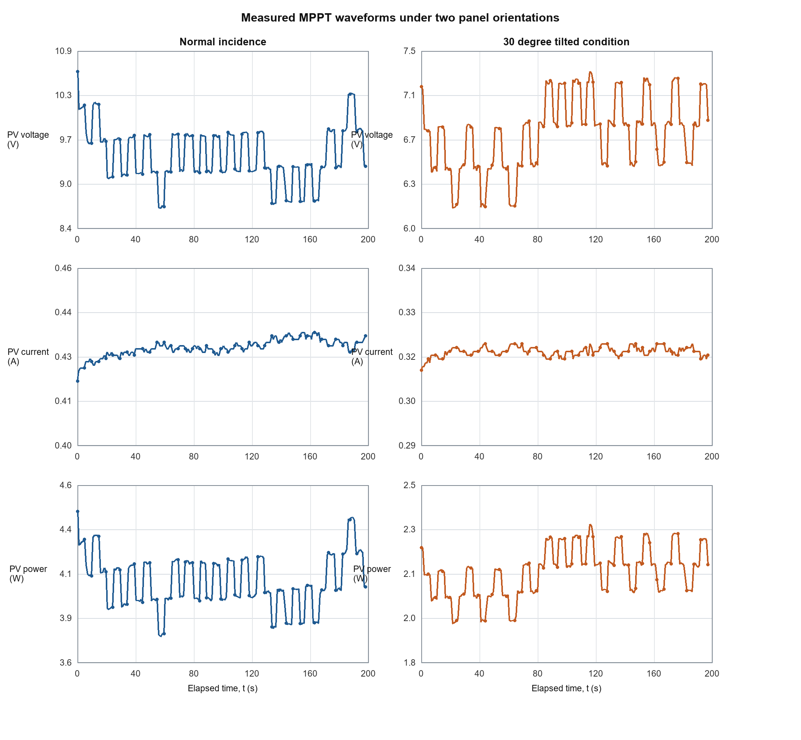
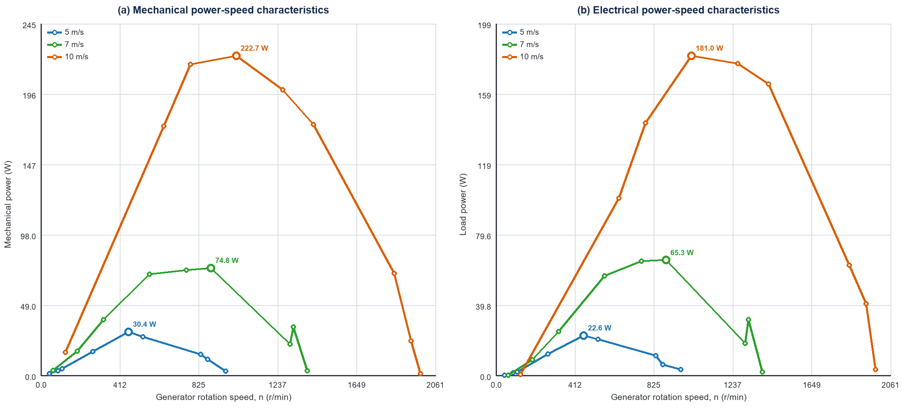

# ELEC5206 · 光伏与风机运行特性实验

[返回作品集](README.md)

**项目形式：三人小组实验。** 根据两份报告的贡献表，我负责**数据处理、图表制作与报告整理**；设备搭建、接线、采集和复核由小组协作完成。

## 光伏 MPPT：从原始记录解释工况变化

对光伏组件、Buck 变换器及扰动观察法 MPPT 控制系统进行实验分析，比较正常入射与倾斜 30° 两组测量。每组保留 201 条有效记录，使用导出的实际时间列，不人为改成等间隔时间轴。

| 指标 | 正常入射 | 倾斜 30° |
|---|---:|---:|
| 记录数 | 201 | 201 |
| 平均电压 / V | 9.440 | 6.770 |
| 平均电流 / A | 0.430 | 0.318 |
| 平均功率 / W | 4.064 | 2.153 |
| 最大记录功率 / W | 4.463 | 2.336 |

平均记录功率下降约 47.0%。实验中高度和灯板距离保持一致，但卤素灯光场、组件温度及控制扰动也会影响结果，不能只用理想余弦投影解释变化。

原始功率列与 V×I 的最大绝对差分别约为 0.0127 W 和 0.0217 W，可用于检查测量列与数据处理的一致性；这一检查本身不等于仪器校准。

## 风机：负载扫描与最大功率点

在 5、7、10 m/s 三种设置下，对不同电阻负载共记录 27 个工况，绘制转矩、转速、电压、电流及机械与电功率关系。

| 风速设置 / m/s | 测得最大电功率 / W | 对应转速 / r/min |
|---|---:|---:|
| 5 | 22.61 | 458 |
| 7 | 65.35 | 889 |
| 10 | 181.00 | 1,022 |

测量中的部分通道因接线极性呈负号。公开 CSV 保留带符号原值，报告曲线按幅值表达；最大功率点效率属于发电机、整流及线路组合的点效率，不作为风轮气动功率系数。

## 可复核成果

本仓库提供清理后的实验台测量列和复核脚本。脚本检查记录数、平均值、功率乘积残差及风机最大功率点。数据清理仅移除空行和非数据标记，并把风速分组显式写为一列。

这些工作体现运行数据整理、测量异常识别、结果可视化和实验条件记录能力。温度、零点偏移及重复性仍是解释测量结果时需要考虑的因素。
