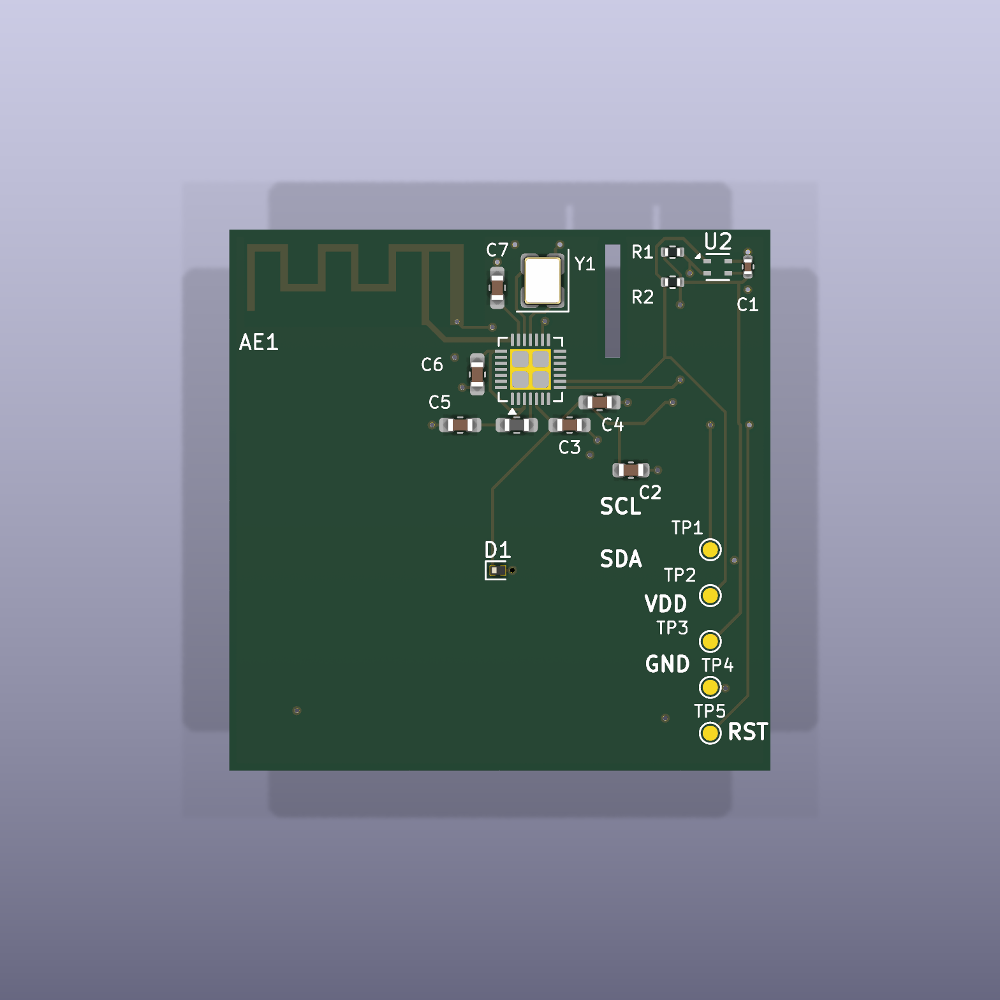
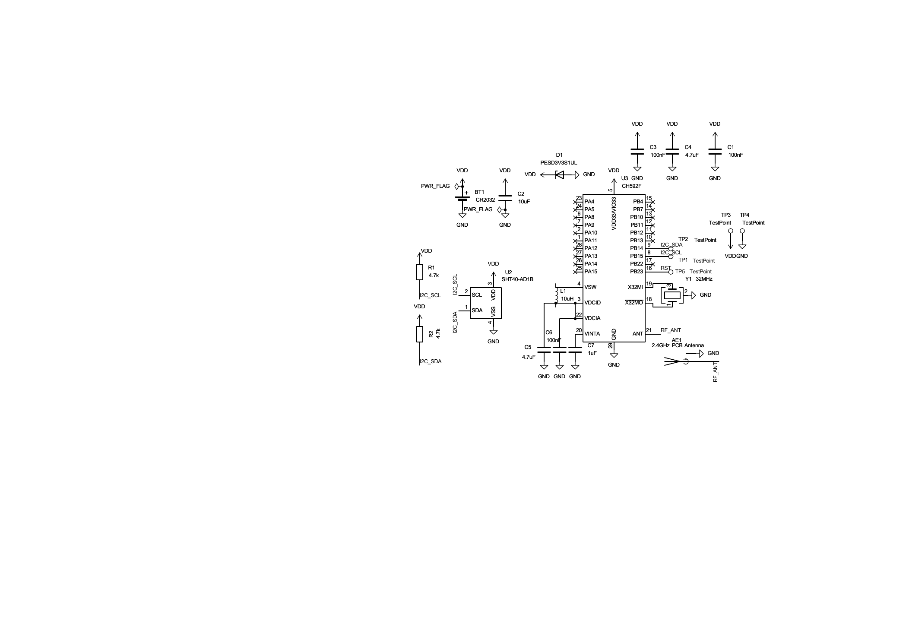

# 实习学习 · PCB 设计与工程资料整理

[返回作品集](README.md)

**施耐德实习项目｜低功耗温湿度传感器节点设计与工程资料整理**

## 八周工作过程

- 学习 KiCad 原理图、器件封装、PCB 布局布线及制造输出的基本流程。
- 检查器件连接、网络标号、测试点与丝印等设计内容，记录修改过程。
- 了解 ERC / DRC 软件规则检查、装配方向核对及工程资料的一致性要求。
- 整理阶段文件、检查证据和后续样机验证计划。

| 阶段 | 主要内容 |
|---|---|
| 第 1–3 周 | 工具学习、系统方案、原理图与 PCB 初版 |
| 第 4–6 周 | 装配资料、设计检查、制造约束及测试性分析 |
| 第 7 周 | 制造资料复核、测试点丝印整改、装配与检查证据整理 |
| 第 8 周 | 整合最终版本、归档交付资料、细化样机验证执行方案 |

## 从设计文件到可验证交付

工程资料需要让不同角色能够核对同一版本：原理图与 PCB 对应，制造输出与源文件对应，装配资料能够解释位号、方向与层别，验证计划能够说明对象、步骤和判据。

一个具体问题是测试点网络名原先位于铜层，而报告将其描述为丝印。后续将标识迁移至丝印层，并同步重新导出制造文件和检查证据。这一过程体现了从实际文件核查问题、修正工程、同步文档与重新验证的工作方法。

第八周交付将资料分为工程源文件、制造、装配、软件检查、样机验证、报告六类，并形成 12 项样机验证计划，覆盖外观、上电、下载复位、传感器接口、测量精度、自热、时钟、无线通信、功耗、机械、ESD 预兼容和连续运行。每项关联样本量、仪器、步骤、定量判据和记录方式。

## 项目成果

- 完成原理图、PCB、制造输出、装配资料与检查记录的整合。
- 第八周 ERC、DRC、未连接与原理图／PCB 一致性检查记录均为 0。
- 形成 12 项样机验证方案，明确测试步骤、仪器、样本量、判据和记录表。
- 项目进度：设计与生产资料整理完成，样机测试待执行。

## 与运维工作的关联

通过检查记录、版本管理和问题修改流程，形成从发现问题、定位文件、实施修改到复核结果的工作习惯；将测试要求转化为具体步骤和记录表，支持后续调试与验证。

## PCB 与原理图

## 工程文件

- [完整 KiCad 工程与制造、装配、检查资料](internship-kicad-engineering.zip)
- [KiCad 项目](Schneider_TempSensor_Pro.kicad_pro)
- [原理图源文件](Schneider_TempSensor_Pro.kicad_sch)
- [PCB 源文件](Schneider_TempSensor_Pro.kicad_pcb)

使用 KiCad 10.0.6 打开项目文件，可查看原理图、PCB 布局与三维结构。
